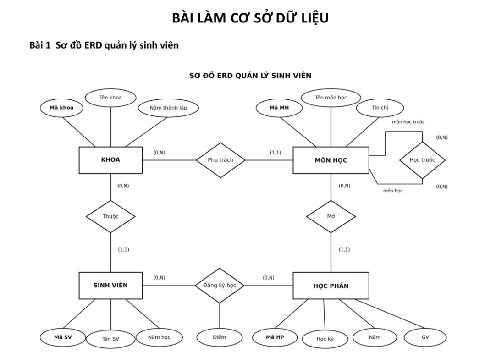

# QUẢN LÝ SINH VIÊN

## 1. ERD

### ERD trực quan



## 2. Lời giải câu 1–15

### Câu 1: Liệt kê tên các sinh viên thuộc khoa “Toán” (MAKHOA = “TOAN”)

```sql
SELECT s.TENSV
FROM SVIEN AS s
WHERE s.MAKHOA = 'TOAN'
ORDER BY s.TENSV;
```

### Câu 2: Liệt kê tên các môn học và số tín chỉ

```sql
SELECT m.TENMH, m.TINCHI
FROM MHOC AS m
ORDER BY m.TENMH;
```

### Câu 3: Liệt kê kết quả học tập của sinh viên có mã số ‘K26.008’ (MASV)

```sql
SELECT m.TENMH, h.MAHP, h.HOCKY, h.NAM, kq.DIEM
FROM KETQUA AS kq
JOIN HPHAN AS h ON h.MAHP = kq.MAHP
JOIN MHOC AS m ON m.MAMH = h.MAMH
WHERE kq.MASV = 'K26.008'
ORDER BY h.NAM, h.HOCKY, m.TENMH;
```

### Câu 4: Liệt kê tên sinh viên và mã môn học mà sinh viên đăng ký với kết quả cuối khóa trên 7 điểm

```sql
SELECT s.TENSV, m.MAMH, kq.DIEM
FROM KETQUA AS kq
JOIN SVIEN AS s ON s.MASV = kq.MASV
JOIN HPHAN AS h ON h.MAHP = kq.MAHP
JOIN MHOC AS m ON m.MAMH = h.MAMH
WHERE kq.DIEM > 7
ORDER BY s.TENSV, m.MAMH;
```

### Câu 5: Liệt kê tên sinh viên thuộc khoa phụ trách môn học “Toán rời rạc”

```sql
SELECT s.TENSV
FROM SVIEN AS s
WHERE s.MAKHOA = (
    SELECT m.MAKHOA
    FROM MHOC AS m
    WHERE m.TENMH = N'Toán rời rạc'
)
ORDER BY s.TENSV;
```

### Câu 6: Liệt kê tên sinh viên, tên môn học và điểm số ở học kỳ 1, năm 1996

```sql
SELECT s.TENSV, m.TENMH, kq.DIEM
FROM KETQUA AS kq
JOIN SVIEN AS s ON s.MASV = kq.MASV
JOIN HPHAN AS h ON h.MAHP = kq.MAHP
JOIN MHOC AS m ON m.MAMH = h.MAMH
WHERE h.HOCKY = 1
  AND h.NAM = 1996
ORDER BY s.TENSV, m.TENMH;
```

### Câu 7: Liệt kê tên các môn học phải học ngay trước môn “Cơ sở dữ liệu”

```sql
SELECT truoc.TENMH AS TEN_MON_HOC_TRUOC
FROM MHOC AS sau
JOIN DKIEN AS d ON d.MAMH = sau.MAMH
JOIN MHOC AS truoc ON truoc.MAMH = d.MAMH_TRUOC
WHERE sau.TENMH = N'Cơ sở dữ liệu'
ORDER BY truoc.TENMH;
```

### Câu 8: Liệt kê tên các môn học phải học ngay sau môn “Cơ sở dữ liệu”

```sql
SELECT sau.TENMH AS TEN_MON_HOC_HOC_SAU
FROM MHOC AS truoc
JOIN DKIEN AS d ON d.MAMH_TRUOC = truoc.MAMH
JOIN MHOC AS sau ON sau.MAMH = d.MAMH
WHERE truoc.TENMH = N'Cơ sở dữ liệu'
ORDER BY sau.TENMH;
```

### Câu 9: Liệt kê tên môn học trước, tên môn học có số tín chỉ nhỏ hơn bằng 4

```sql
SELECT truoc.TENMH AS TEN_MON_HOC_TRUOC,
       sau.TENMH AS TEN_MON_HOC
FROM DKIEN AS d
JOIN MHOC AS sau ON sau.MAMH = d.MAMH
JOIN MHOC AS truoc ON truoc.MAMH = d.MAMH_TRUOC
WHERE sau.TINCHI <= 4
ORDER BY sau.TENMH, truoc.TENMH;
```

### Câu 10: Liệt kê sinh viên và điểm môn “Cơ sở dữ liệu” ở học kỳ 1 năm 1996, sắp điểm giảm dần, trùng điểm thì tên tăng dần

```sql
SELECT s.MASV, s.TENSV, kq.DIEM
FROM KETQUA AS kq
JOIN SVIEN AS s ON s.MASV = kq.MASV
JOIN HPHAN AS h ON h.MAHP = kq.MAHP
JOIN MHOC AS m ON m.MAMH = h.MAMH
WHERE m.TENMH = N'Cơ sở dữ liệu'
  AND h.HOCKY = 1
  AND h.NAM = 1996
ORDER BY kq.DIEM DESC, s.TENSV ASC;
```

### Câu 11: Liệt kê mã học phần và số lượng sinh viên đăng ký theo từng học phần

```sql
SELECT h.MAHP, h.MAMH, COUNT(kq.MASV) AS SO_LUONG_SINH_VIEN
FROM HPHAN AS h
LEFT JOIN KETQUA AS kq ON kq.MAHP = h.MAHP
GROUP BY h.MAHP, h.MAMH
ORDER BY h.MAHP;
```

### Câu 12: Liệt kê tên sinh viên và điểm trung bình trong từng học kỳ của từng niên học

```sql
SELECT s.MASV, s.TENSV, h.HOCKY, h.NAM,
       AVG(CAST(kq.DIEM AS decimal(5,2))) AS DIEM_TRUNG_BINH
FROM SVIEN AS s
JOIN KETQUA AS kq ON kq.MASV = s.MASV
JOIN HPHAN AS h ON h.MAHP = kq.MAHP
GROUP BY s.MASV, s.TENSV, h.HOCKY, h.NAM
ORDER BY h.NAM, h.HOCKY, s.TENSV;
```

### Câu 13: Liệt kê tên sinh viên đạt điểm cao nhất

```sql
SELECT s.MASV, s.TENSV
FROM SVIEN AS s
JOIN KETQUA AS kq ON kq.MASV = s.MASV
WHERE kq.DIEM = (SELECT MAX(DIEM) FROM KETQUA)
ORDER BY s.TENSV;
```

### Câu 14: Liệt kê tên sinh viên có điểm cao nhất môn “Cơ sở dữ liệu” ở học kỳ 1 năm 1996

```sql
SELECT s.MASV, s.TENSV, kq.DIEM
FROM KETQUA AS kq
JOIN SVIEN AS s ON s.MASV = kq.MASV
JOIN HPHAN AS h ON h.MAHP = kq.MAHP
JOIN MHOC AS m ON m.MAMH = h.MAMH
WHERE m.TENMH = N'Cơ sở dữ liệu'
  AND h.HOCKY = 1
  AND h.NAM = 1996
  AND kq.DIEM = (
      SELECT MAX(kq2.DIEM)
      FROM KETQUA AS kq2
      JOIN HPHAN AS h2 ON h2.MAHP = kq2.MAHP
      JOIN MHOC AS m2 ON m2.MAMH = h2.MAMH
      WHERE m2.TENMH = N'Cơ sở dữ liệu'
        AND h2.HOCKY = 1
        AND h2.NAM = 1996
  )
ORDER BY s.TENSV;
```

### Câu 15: Liệt kê tên sinh viên có điểm trung bình cao nhất ở học kỳ 1 năm 1996

```sql
WITH DIEM_TB AS (
    SELECT s.MASV, s.TENSV, AVG(CAST(kq.DIEM AS decimal(5,2))) AS DIEM_TRUNG_BINH
    FROM SVIEN AS s
    JOIN KETQUA AS kq ON kq.MASV = s.MASV
    JOIN HPHAN AS h ON h.MAHP = kq.MAHP
    WHERE h.HOCKY = 1
      AND h.NAM = 1996
    GROUP BY s.MASV, s.TENSV
)
SELECT MASV, TENSV, DIEM_TRUNG_BINH
FROM DIEM_TB
WHERE DIEM_TRUNG_BINH = (SELECT MAX(DIEM_TRUNG_BINH) FROM DIEM_TB)
ORDER BY TENSV;
```
